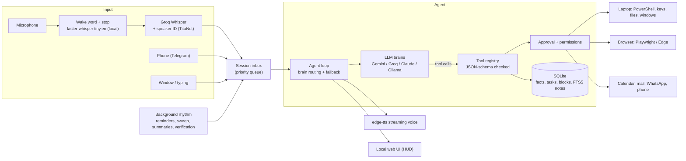

# Jay: a voice-first personal AI agent for Windows

Jay is an LLM agent that lives on your laptop. Say **"Hey Jay"** and talk, or message it from your phone.
It chooses between **90 tools** (calendar, tasks, reminders, files, browser, PowerShell, WhatsApp, mail,
your own notes) to get things done, keeps **memory** between days, learns your routines, and checks real
evidence (your public LeetCode and GitHub profiles) before it believes a task was finished.

It is built to be **useful every day**, not a demo: it runs in the background from Windows start-up, speaks up
twice a day (a morning and an evening summary) instead of pinging you, and asks before anything it
can't undo.

> Status: personal project, in daily use. Windows 10/11, Python 3.12+. No demo video yet; see
> [Try it](#try-it) for what to say.

## What it does

| Area | What Jay does |
|---|---|
| **Voice** | Local wake word ("Hey Jay" / "Stop Jay"), accurate speech-to-text, British neural voice that streams as it speaks, speaker recognition so only the owner can use private tools |
| **Schedule** | Keeps your tasks, re-plans the day, reads a Google Calendar feed, sends a **morning and an evening summary** when you are at the laptop, exports your plan as `.ics` |
| **Follow-through** | Tracks each planned block as done / missed / moved, carries a missed one forward once, and **verifies work from public LeetCode and GitHub activity** |
| **Laptop control** | Launches apps, manages windows, types and presses keys, runs PowerShell, reads and writes files, looks at the screen, controls volume and media |
| **Browser** | Its own Edge window (via Playwright) for sites you are signed in to, one tab per site. It never types passwords |
| **Memory** | A profile, saved facts, learned patterns and insights, searchable history, and **RAG over your own PDFs, slides and notes with page citations** |
| **Phone** | Two-way chat through a private Telegram bot (text or voice notes), one-way push through ntfy; approvals arrive as Allow / Deny buttons |
| **Safety** | Approval cards for outward actions, an owner-only voice gate, standing permissions with expiry, and a short list of things that always ask |

## How it works



### The agent loop

`Agent.ask()` stamps the request with the date and the next seven days, picks a brain, and runs
`provider.turn()`: the model either answers or returns tool calls; each call is validated against the
tool's JSON Schema, checked for approval, executed, and its result is fed back, until the model answers.
Independent calls run in parallel; browser and WhatsApp tools run on one dedicated thread because
Playwright's sync API is thread-affine.

### Design decisions worth knowing

- **Brain routing instead of one model.** Several free-tier LLMs are tried in order. Each provider's
  latency is measured (moving average); a rate-limited brain is skipped until its limit resets, a stalling
  model is benched for a minute and returns later, and a clearly faster brain is preferred unless you pinned one.
  A brain that fails after tools already ran is *not* retried elsewhere (that would repeat side effects).
- **Small prompts on purpose.** Free tiers allow roughly 8k tokens a minute, so the "lean" brains get ~28 everyday
  tools and switch on groups (`files`, `browser`, `mail`, `creator`, ...) with an `enable_tools` meta-tool.
- **Talking over it works.** A new request while one is in progress replaces it. Each turn carries a *generation*
  number; the replaced turn removes itself from the history, runs no more tools and stays silent. Wording
  and timing decide whether new speech is a **continuation** (merged into the request), a **correction**
  (replaces it, old request kept as context) or **new**.
- **Quiet by design.** Planned blocks never ring one by one. A scheduler decides *when you are at the laptop*
  (Windows' idle timer) and sends one morning and one evening summary; a missed block is carried once, merged
  if a twin exists, then dropped (an earlier version re-announced it all day, which is why this exists).
- **Evidence over ticks.** Blocks titled like LeetCode or coding work are checked against the public
  LeetCode GraphQL API and GitHub events; proof marks the block done and says why.
- **Layered memory.** Profile (always in the prompt) > learned patterns and insights (always shown) > recent
  facts > searchable history > a notes knowledge base (SQLite FTS5, Porter stemming, BM25, page-level citations).
  A daily reflection turns conversations and measured behaviour into new patterns; `rag_eval` self-tests retrieval.
- **Supervised autonomy.** Everything outward-facing needs a yes unless you grant it. `/autoapprove` lets everyday
  actions run, but never email, power actions, publishing, skill installs or destructive commands, and from the
  phone shell/typing/file writes still ask. Text from the web, mail or chats is treated as data, never instructions.

## Tech stack

| Layer | Used |
|---|---|
| Language | Python 3.12+ (stdlib `threading`, `sqlite3`, `http.server`) |
| LLMs | Gemini and Groq (OpenAI-compatible API), Claude, Ollama; `openai`, `anthropic`, `ollama` SDKs |
| Speech | `faster-whisper`, Groq Whisper `large-v3`, `sherpa-onnx` (NVIDIA TitaNet-small), `edge-tts`, `sounddevice`, PyAV |
| Data | SQLite with FTS5; `pypdf` for documents |
| Automation | Playwright (Microsoft Edge), Windows APIs via `ctypes`, PowerShell |
| Integrations | Google Calendar (iCal / OAuth), IMAP/SMTP, Telegram Bot API, ntfy, LeetCode GraphQL, GitHub API |
| UI | A local web page (token-protected, 127.0.0.1 only) shown in an Edge app window |
| Quality | 350+ offline `unittest` tests using scripted fake LLMs, fake pages and synthetic audio |

## Project layout

```
jarvis/
  agent.py        system prompt, brain routing, learning, proactive routines
  providers.py    OpenAI-compatible / Claude / Ollama adapters, rate-limit and stall handling
  session.py      worker thread, inbox, preemption, scheduler, approvals, phone link
  voice.py        wake word, utterance detection, STT, TTS, microphone watchdog
  speakers.py     speaker identification
  dialogue.py     continuation / correction / new-request rules
  planner.py      done/missed tracking, free-slot search, weekly summary
  rhythm.py       when to speak up (morning / evening, at-laptop detection)
  verify.py       LeetCode / GitHub evidence
  brief.py        morning and evening summary data
  store.py        SQLite layer, FTS5 knowledge base
  grants.py       standing permissions and auto-approve rules
  tools/          registry plus pc, browser, web, mail, google, whatsapp, knowledge ...
tests/            offline test-suite
docs/USER_GUIDE.md   the full user manual (commands, setup of every integration)
```

## Getting started

```bash
git clone https://github.com/Rohith-vijay/Jay.git
cd Jay
python -m venv .venv
.venv\Scripts\pip install -r requirements.txt -r requirements-voice.txt
copy .env.example .env        # add at least one free key: GEMINI_API_KEY or GROQ_API_KEY
.venv\Scripts\python -m jarvis --console      # terminal mode, or: jarvis.bat   (window + voice)
```

Run the tests (no keys or network needed): `.venv\Scripts\python -m unittest discover -s tests -t .`

Microsoft Edge must be installed for the browser tools. Everything else (calendar link, Telegram bot,
LeetCode/GitHub usernames, mail) is optional and described in `.env.example` and the
[user guide](docs/USER_GUIDE.md).

## Try it

- "Hey Jay, what's on my calendar tomorrow?"
- "Create a folder called demo on the desktop, and then open it." (say the second part after a pause: it is merged)
- "No, call it Projects instead." (a correction while it is working)
- "Did I do my LeetCode today?" (checks your public profile)
- "Learn the file D:\notes\os.pdf", then "what are the conditions for deadlock?" (answer with a page citation)
- From the phone: any of the above through the Telegram bot.

## Known limitations

- Windows only; it depends on a working microphone driver. There is no echo cancellation, so talking over Jay at the
  volume of its own voice can be missed (a hotkey and "Stop Jay" are the fallbacks).
- Free LLM tiers vary from 1 to 10+ seconds per call; a paid low-latency model is a one-line change.
- Retrieval is keyword-based (BM25), not semantic embeddings, so a question phrased very differently from the notes can miss.
- A replaced request stops at its next step; tool side effects that already happened are not undone.
- Some integrations (mail, a few Telegram paths) were tested offline only.

## Credits and licences

Some built-in skills in `jarvis/skills_builtin/` are adapted from [Hermes Agent](https://github.com/NousResearch/hermes-agent)
(MIT) and OpenJarvis (Apache-2.0); their licences are included in that folder. The rest is original work.
